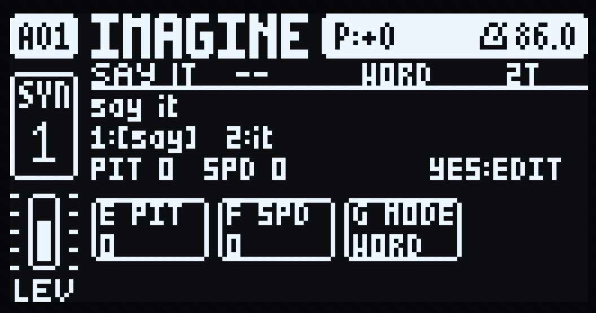
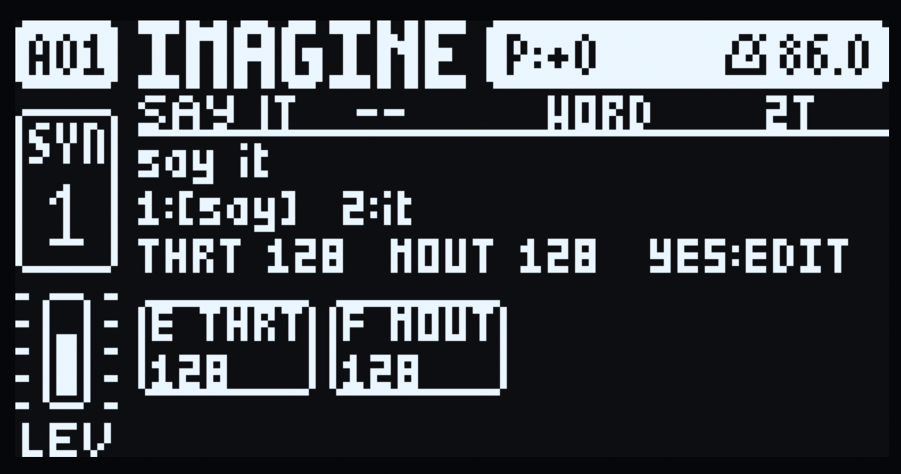
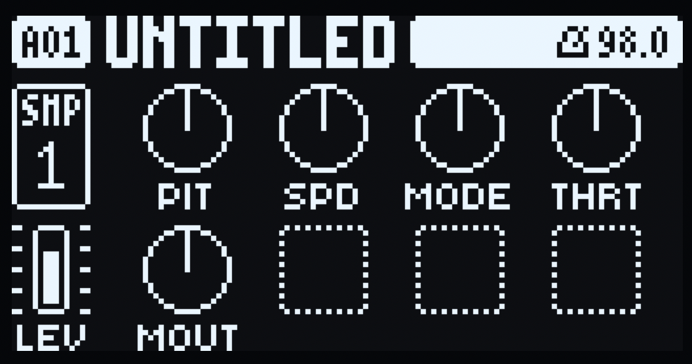
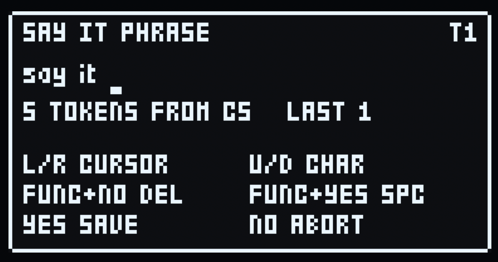

# SAY IT - a SAM speech machine for the Digitone mk1 and the Digitakt mk1

SAY IT puts **S.A.M. - Software Automatic Mouth**, the 1982 speech
synthesiser, inside the Digitone as a machine. Type a phrase on the
factory-style naming screen, then play its words (WORD) or characters
(CHAR) from Keyboard mode or the sequencer.

The voice is SAM itself. Its reciter turns English into phonemes, its formant
synthesiser renders them as an 8-bit stream at 22050 Hz, and the mod resamples
that to the machine's 48 kHz and hands it to the track's voice - so the
multimode filter, mixer, effects and AMP envelope still shape it like FM. Each
track loads its own SAY IT with its own phrase and voice, and every phrase is
saved with the project.

Pick it per track from **MACHINES** (hold a track key). A sound's machine is
its sound slot 0, so sound locks switch engines per trig, and p-locks, LFOs and
presets work on its knobs as on FM.

Digitone mk1 and Digitone Keys, OS **1.44** only.

There is also a **Digitakt mk1** machine, in
[machines/digitakt](machines/digitakt). It is built and checked in the emulator
only, and has not run on hardware. Its phrase is kept in the track's own sound,
so it is saved with the pattern - but a Digitakt sound has room for 20
characters, against the Digitone's 255. See [The Digitakt
machine](#the-digitakt-machine).

## Install

SAY IT is distributed as a mod, and nothing else - no OS image. You supply the
stock OS file Elektron publishes and build a custom OS on your own machine with
[elekloader](https://github.com/irpina/elekloader):

- **Digitone mk1**, `sayit-1.0a-digitone.elemod`, against the stock **OS 1.44**.
- **Digitakt mk1**, `sayit-1.0a-digitakt.elemod`, against the stock **OS 1.54**.

Each build carries its device in the file name, so both can sit on one release
page: the name says which unit the file is for, and a build refuses a mod made
for the other device.

- **In a browser:** <https://irpina.github.io/elekloader/>. Drop in your stock
  OS file, add that machine's `.elemod`, tick the companions it needs
  (**core-dn1** 4.0 + **machines** 0.2 for the Digitone, **core** 4.0 +
  **machine-pages** 1.2 for the Digitakt), build, download.
- **From source:** `python -m elekloader`, then pick the same mods.

Send the result to the unit with Elektron Transfer, as for any OS update. The
build is yours: it contains Elektron's firmware, so keep it to your own unit.

If a custom OS will not start, hold **FUNC** while powering on, press
**TRIG 4** (OS UPGRADE) and send the stock OS `.syx`. The bootloader is never
touched, so that always restores the unit.

Requires **core-dn1 4.0** (or newer) and the **machines** companion **0.2**: the
machine plays through machines' voice path, and the mod reads the firmware
locations, the parameter slots and the LFO state core exports. The Digitakt
machine needs **core 4.0** and **machine-pages 1.2** instead.

## Controls

Borrowed stock parameters only - no param:182-184 minted.

The first page of SYN1 and the first page of SYN2 become the machine's own:

| SYN1 - SAY IT page 1 | SYN2 - SAY IT page 2 |
|---|---|
|  |  |

SYN1 carries pitch, speed and the WORD/CHAR mode on encoders E, F and G; SYN2
carries the throat and mouth shaping on E and F. Above the cells sit the header
with the last note played, the phrase window, the token strip, and the line that
summarises the page (or names the token that just sounded) and ends in YES:EDIT.
Both shots are the stock INIT sound with the default phrase, before a note has
been played, which is why the header shows `--` where the note name goes.

| knob | label | stock param | range / behaviour |
|---|---|---|---|
| SYN1 E | PIT | HARM (37..89) | pitch offset, two octaves each way: +24 semitones clockwise, -24 counter-clockwise |
| SYN1 F | SPD | DTUN (0-127) | speaking speed, centred on SAM's own |
| SYN1 G | MODE | FDBK (0-127) | WORD in the lower half, CHAR in the upper |
| SYN2 E | THRT | 0-127 | throat offset (the cell shows SAM's resulting 0-255 value) |
| SYN2 F | MOUT | 0-127 | mouth offset (SAM's 0-255 value) |

All five controls sit on the **lower encoder row** (E-G on SYN1, E-F on SYN2),
so every cell is drawn in the screen's lower band, under the encoder that
edits it. (The Digitone's eight encoders are two rows of four, A-D above E-H,
and the screen's two halves match them.)

SYN1 A-D and H, SYN2 A-D and G-H stay unused. An unused knob still turns the FM
parameter underneath (upstream limit, unheard while SAY IT plays). Normal
16-knob layout; no DNM_PAGES2.

PIT is a plain semitone control: turning it up raises the audible pitch. Its
cell shows the semitone offset (-24..+24), not HARM's raw value. SPD is centred
on SAM's own speed; turning it up speaks faster.

The transposition scales the glottal pulse SAM fetches by a Q15 factor
(`period_q15`): +12 halves each pulse, +24 quarters it, -12 doubles it and -24
quadruples it, so every step is exact. It deliberately does not ride SAM's
`pitch` control: SAM adds that value *before* subtracting half of frame F1, so
the interval it produces depends on the vowel (halving it at 64 came out a
twelfth-and-a-half in the emulator). The played note uses the same factor,
which is why a key a semitone up speaks a semitone higher.

## The voice

There is one voice per track - SAM's own default, the stock settings
s-macke/SAM starts with: speed 72, pitch 64, throat 128, mouth 128. PIT, SPD,
THRT and MOUT are offsets around those, so a freshly picked SAY IT is SAM as SAM
sounds with no options.

Each track that loads SAY IT is its own instrument: its own phrase (saved per
track in the project, four of them), its own knob values (the track's sound, as
for any machine), its own page state and its own SAM engine, so T1 keeps
talking while T2 starts a word.

## Token mapping

`token index = note name - C5`. The root is **C5**, which in the Digitone's
own note naming is MIDI **60** (the unit prints MIDI 72 as C6: the name is the
letter for note % 12 and the number note / 12). C5 is token 1 and the note at
which the voice is untransposed; each semitone above it selects the next token
**and raises the speech one semitone**, so a CHAR-mode `say it` is S on C5, A on
C#5, Y on D5. A note below C5, or above the phrase's last token, plays nothing -
there is no wrap, so the phrase never restarts under your fingers and the pitch
never jumps back down. The page header shows the last note played by that name
(`C5`), so the mapping is visible rather than guessed. Note-off never truncates
speech; tokens play to completion. Newest note wins with a short de-click fade.

There is no ROOT knob: the base is fixed at C5, so with Keyboard at its default
octave the C key starts the phrase and no setup is needed. Transposing the
Keyboard with its UP/DOWN arrows moves the physical keys, not the base; if a key
sits outside `C5..C5+tokens-1`, the page says so, e.g. `A#6 OUTSIDE 2T`,
instead of leaving you guessing why it is silent.

The Digitakt keeps the same map: the first word is on MIDI note 60, the note the
unit calls **C5**.

## Pages

Both SYN first pages become SAY IT pages. The upper half shows the header
(`SAY IT C5 WORD 2T`), the phrase window and the token strip (`1:[say] 2:it`);
while a trig is held the cells show that step's locks, inverted (see below); the
lower band holds that page's controls in wide cells, each under its encoder and
showing only its encoder letter, label and value: SYN1 PIT/SPD/MODE on E/F/G,
SYN2 THRT/MOUT on E/F. The line above the cells summarises the page, or names
the token that just sounded, and ends with **YES:EDIT**; a note outside
`C5..C5+tokens-1` shows `A#6 OUTSIDE 2T` there, so a silent key is explained
rather than mysterious.

Everything in that column starts on the stock header's name column - the left
edge of the U in UNTITLED, x=18 - on both pages: the rule under the header, the
header itself, the phrase, the token strip, the status line and the cell frames.
The second pages (`2/2`), rail, title bar and status stay stock; without
DNM_PAGES2 they are still FM's.

**YES** on a SAY IT page opens the naming screen. That is the only way in: the
mod deliberately adds no Mod Menu entry, so it appears only under MACHINES when
a track plays SAY IT (whose tile in that menu is a mouth). No stock text-input
window is exposed via `fw_*`, so SAY IT draws its own modal screen with the
stock fonts, following the factory NAMING screen (manual 6.5):

| key | action |
|---|---|
| LEFT / RIGHT | move the cursor |
| UP / DOWN, LEVEL/DATA | select the character under the cursor |
| hold FUNC | the 15 x 6 character pop-up (arrows move, LEVEL moves rows) |
| release FUNC | insert the highlighted character |
| FUNC + YES | insert a space |
| FUNC + NO | delete the character before the cursor |
| YES | save and close |
| NO | abort, leaving the phrase unchanged |

The cursor is the factory's framed cell; at end-of-text a step appends one
character and stays on it, so turning LEVEL types one character rather than a
run of them. `EDITED` marks unaccepted changes. The phrase lives in the project
data (`projdata:SAYI`) and is restored with the project. Encoders are only taken
while the naming screen is up, so PIT/SPD/MODE stay live on the pages.

Upstream limits: the turn popup's long names and the LFO destination lists keep
the stock names; SYN1's algorithm diagram and SYN2's envelope graphs are covered
by the SAY IT pages, and the second pages are FM's.

## Parameter locks and the LFOs

The five knobs are the stock FM parameters' own - their sound slots, ranges and
p-locks - so both work on SAY IT as they do on FM.

**A p-lock plays its value.** Lock PIT, SPD, MODE, THRT or MOUT on a step and
that trig speaks with it, as a lock on any FM parameter would.

**A held trig shows that step's values.** Hold any trig, in GRID or STEP record
or out of it, and both SAY IT pages show that step's locked values in place of
the sound's, with each locked cell inverted, as the stock p-lock pages do. The
phrase, the token count and the summary line follow the same values, so a locked
MODE or SPD reads as the step will play it. The step reads from the shown
pattern's first page (1:4) - the same assumption other mods make.

**The pages yield only to a popup.** Copy, paste and clear - FUNC, PTN or PAGE
with RECORD, PLAY or STOP - raise the firmware's message box in the page's own
view, so the overlay steps aside for as long as it is up and then repaints.
Everything else reports itself in the top bar above the pages (a bare RECORD,
RECORD+PLAY for LIVE, RECORD+STOP for STEP, the note playing, T1 PLAYING), so
the overlay stays up.

**The two system LFOs reach the voice.** A machine's voices never take FM's
path, so the firmware's LFOs - which modulate FM's working copy of the sound -
would have been inaudible. SAY IT adds them itself, per voice, to the knobs
whose slot each LFO points at, clamped to the knob's stock range. An LFO on
**PIT** is a vibrato and an LFO on **SPD** a speed wobble on the word that is
already speaking: SAM reads both as it goes. THRT, MOUT and MODE are baked into
SAM when a token starts, so an LFO on them colours the next token rather than
moving inside one - and with no LFO assigned, nothing is added and the render is
exactly what it was.

| LFO destination | what moves |
|---|---|
| SYN1 E (PIT) | vibrato, live |
| SYN1 F (SPD) | speed wobble, live |
| SYN1 G (MODE) | WORD/CHAR, at the next token |
| SYN2 E (THRT), SYN2 F (MOUT) | formants, at the next token |

## Signal path

```
phrase -> tokenise (WORD/CHAR) -> letter names (CHAR: "B" -> "bee")
-> SAM reciter: English -> phonemes (SAM's own rule tables)
-> SAM renderer: glottal/noise excitation -> formant synthesis (22050 Hz, 8-bit)
-> linear-interpolation resample to 48000 Hz
-> newest-wins mono voice per track -> Digitone filter/mixer/effects/AMP
```

**The AMP envelope shapes the words.** SAY IT renders into the track's own
voice, so the stock AMP page still gates it: a short DEC or a SUS of 0 turns
each word into a click. On the AMP page lengthen DEC, set SUS to max, and give
REL some room.

## The Digitakt machine

**Status: built and checked in the emulator, not yet played on hardware.** Treat
it as a working port that nobody has heard on a Digitakt.

The same speech, in a device built the opposite way round. The Digitone renders
its FM voices on a second CPU and a machine borrows them; the Digitakt has no
such engine, so a machine renders the track's audio itself, 32 samples a block,
and the track's filter, AMP envelope, level, effects and LFOs then work on it
as on a sample. SAY IT's voice therefore *is* the track's sound, and there is
no voice allocation to do: each of the eight audio tracks renders its own words
with its own SAM engine.

Everything above about the voice, the token mapping and the C5 root holds
unchanged. What differs:

| | Digitone | Digitakt |
|---|---|---|
| controls | five borrowed FM parameters, on the SYN pages | the machine's own eight SRC-page parameters, A-E |
| page | both SYN first pages redrawn | machine-pages' SRC page, as described by the machine; F-H blank |
| phrase entry | YES on a SAY IT page | YES on the SRC page of a track whose sound is SAY IT |
| per-track phrase | saved in the project (`projdata:SAYI`), 255 characters | saved in that track's sound, 20 characters |
| tracks | 4, one engine each | 8, one engine each |

The five controls are **PIT** (A), **SPD** (B), **MODE** (C), **THRT** (D) and
**MOUT** (E), with the same ranges and the same value texts as the Digitone's,
PIT on the same 37..89 window so a p-lock means the same semitones on both. They
are the sound's own parameter slots, so p-locks, the two system LFOs, Randomize,
MIDI CC 16-23 and NRPN reach the voice with nothing added by the machine.

A fresh machine loads with every knob at its neutral position: PIT 0, SPD 0,
MODE **CHAR**, THRT 128, MOUT 128. (The Digitone machine still defaults to WORD,
so the first word is one char per key here and one word per key there.) A sound
that was already saved keeps the MODE it was saved with.

| SAY IT loaded on the SRC page | The phrase editor, one YES away |
|---|---|
|  |  |

Both are the stock INIT pattern with SAY IT on track 1 and the default phrase,
before a note has been played. The SRC page is machine-pages' own: the five
controls sit on A-E, F-H stay blank, the tile keeps the unit's sample readout
(`SMP 1`), and LEV and the rest of the rail are the track's as on any machine.
**YES** on that page opens the editor - the phrase on its own line with the
cursor bar under the character it edits, the token count for the track's MODE,
the note the phrase starts from (C5), the token last played, and the keys.

The editor is the same factory-style naming screen, drawn as a modal over
whatever the unit is showing, and it takes input only while it is open:
LEFT/RIGHT move the cursor, UP/DOWN or an encoder picks the character,
FUNC+NO deletes, FUNC+YES inserts a space, YES saves, NO aborts. It opens on
**YES**, as on the Digitone, on the SRC page of a track whose sound is SAY IT.
FUNC+YES is left alone: it is the unit's own chord.

A save leaves its confirmation - `PHRASE SAVED T1` and the track - for a moment
in a box of its own: the editor's black ground and outline, so the knobs under
it are covered rather than run through. Then the page is the stock one again,
untouched.

The page matters because YES is a confirm key everywhere else, and a mod is
given no signal for which page is up. So the machine keeps track of it from the
keys: SRC sets it, every other page key clears it, and so does any key that can
raise a menu or a dialog over the page (GLOBAL, PTN, BANK, SONG, SAMPLE, TEMPO,
TRIG, PAGE, TRK). The unit boots on SRC, so a freshly loaded SAY IT is one YES
away; after visiting any other page, press SRC first.

**Playing it.** The first word is on **MIDI note 60**, the note the unit calls
**C5**, and each semitone above it is the next token - so a word phrase plays
from C5 up, one word a key, and a CHAR phrase from C5 up one letter a key. A
note below C5 or past the last token plays nothing. Two ways to send it:

- **A trig.** On the TRIG page set NOTE to C5 (a new trig already is), place the
  trig and press PLAY. Raise NOTE by a semitone for the next word.
- **The keyboard.** FUNC+TRK opens the chromatic keyboard, where the trig keys
  become notes; play C5 and up live.

**Where the phrase is kept.** The Digitakt's core gives a mod no project data
(that is a core-dn1 feature), so the only thing a machine here can save is its
own sound. A sound is 53 parameter slots; the stock parameters own 1-45,
machine-pages 1.2 gives a machine 46-52 as seven "extra values", and SAY IT's
blank F-H parameters are 22-24. Ten words that the machine does not use as
knobs, two characters each: **20 characters**, written into the sound whenever a
phrase is saved and read back from it on the UI tick. The unit saves the sound
with the pattern and the project, so the phrase comes back after a power cycle.

The Digitone has no such limit because its core saves a mod's own block with the
project (`projdata:SAYI`, 255 bytes); a sound has 153 bits of room, not a block.

Two things follow from keeping it there:

- The words are ordinary sound parameters, so an LFO or a MIDI CC aimed at one
  of them changes the phrase, and the machine takes the change as the phrase.
- A pattern saved before the phrase lived in the sound carries none, so its SAY
  IT tracks come back with the default phrase `say it` rather than silence.

One limit of the device is core's rather than the machine's:

- **No SETTINGS row.** A row's label is a `std::string` built by the firmware's
  own string constructor, whose address core does not export; naming it per OS
  is exactly the invented-address kind of thing this project does not do. The
  key chord is the door instead.

## Files

| | |
|---|---|
| `sayit.h` | SAY IT's own layer, shared by both machines: tokenise, note mapping and note names, the voice controls, resampling to 48 kHz (host-tested) |
| `sayit_chars.h` | the 90-character phrase alphabet, and its lookup (shared, host-tested) |
| `sayit_edit.h` | the pure phrase-editor model: cursor, character stepping, pop-up grid (host-tested) |
| `sam/` | the SAM port: `sam_port.c`, `reciter.c`, SAM's tables, `sam_api.h`; one engine per track in `sam_multi.c` + `sam_inst.h` + `sam_engine_1..7.c`; see [sam/README.md](sam/README.md) |
| `machines/digitone/` | the Digitone machine: `mod.json` (id `sayit`, `dnmachine:77`), `engine.c` (descriptor, knobs, render, formatters, defaults), `overlay.c` (the pages and the naming screen), `dn_knobs.h` (its knob map) |
| `machines/digitakt/` | the Digitakt machine: `mod.json` (machine 77), `engine.c` (descriptor, the per-track render, the SRC-page knobs, the phrase in the sound), `overlay.c` (the phrase editor), `phrase_store.h` (how a phrase is packed into a sound's words, host-tested) |
| `scripts/setup.sh` | fetch and pin the `3rdparty/` checkouts the build and tools need |
| `scripts/build.sh` | build + lint + patch one machine, writing the `.elemod` and a local test image |
| `tools/sayit_host_test.py` | host tests: compiles the real C core and drives every case |
| `tools/sam_parity.py` + `sam_parity.c` | render the same phrases through upstream SAM and the port, and compare byte for byte |
| `tools/vendor_sam.py` | regenerates `sam/sam_port.c` and `sam/reciter.c` from a SAM checkout, failing if the upstream text has moved |

## Build from source

You need Python 3, the m68k toolchain (`m68k-elf-`), a stock OS `.syx`
(Elektron's download), and the `3rdparty/` checkouts:

```sh
sh scripts/setup.sh
python3 tools/sayit_host_test.py     # host core and both manifests, no hardware needed
sh scripts/build.sh digitone <stock Digitone OS 1.44 .syx>
sh scripts/build.sh digitakt <stock Digitakt OS 1.54 .syx>
```

`scripts/build.sh` takes the machine's folder under `machines/` and that
device's stock file; it builds the device's core and companion plus the mod,
lints the combination, and writes two artifacts to `out/`:

- `out/sayit-1.0a-<device>.elemod` - the file to hand out (`sayit-1.0a-digitone`
  or `sayit-1.0a-digitakt`) and to feed to elekloader to build a custom
  firmware. elekloader's own copy stays in `machines/<device>/out/`.
- `out/sayit-1.44-1.0a.syx` or `out/sayit-1.54-1.0a.syx` - a patched OS image
  for your own unit. It contains Elektron's firmware, so it is yours alone and
  `out/` is ignored.

`3rdparty/` is ignored: elekloader and the SAM copy each have their own
repository and licence, so neither is vendored here.

## Verified

- `python3 tools/sayit_host_test.py` - 139 checks over the real C core, green.
- `python3 tools/sam_parity.py` - 20 phrases rendered by SAM and by the port,
  byte-identical.
- `emu.fwcheck` (digiemu) - each built image boots, settles and runs with no
  violations of its own, and its screens match stock at each check point.
- In digiemu: two tracks speaking at once, the C5 root, a held trig's locked
  values in GRID and in LIVE, and the page stepping aside only for a popup. The
  lock row is poked in RAM there, because that emulator cannot turn an encoder
  on a page the way a player does.
- On a Digitone mk1 at 1.44: the MACHINES tile, both pages, the naming screen and
  its keys, the five knobs, p-locks playing their values, a held trig showing its
  step's locked values, one instance per track, the two system LFOs, and the page
  staying up through RECORD+PLAY while FUNC+RECORD's COPY PATTERN puts it aside.

Digitakt machine, in the emulator only:

- `elekloader.lint` - it links as core 4.0 > machine-pages 1.2 > sayit 1.0a,
  164,448 of 262,144 bytes of the mods' RAM, no sites of its own (every firmware
  location it uses is a core 3.0 export, so it names no address).
- The phrase store, in the host tests: a phrase packs into the sound's ten words
  and unpacks again, every character of the alphabet in every position, an empty
  phrase stores as a phrase rather than as "never written", and every word stays
  inside the range a saved extra value has to stay in.
- `emu.fwcheck` (digiemu) on the built 1.54 image: container, bootloader, boot
  and run all pass, and all nine scripted screens are identical to stock - the
  build boots and changes nothing it was not asked to. The audio differs in one
  100 ms window of the recording, the same cycle-shift the Digitone's core
  shows.
- In digiemu: SAY IT loaded from the machine menu on the SRC page, the editor
  and its keys, chromatic mode (FUNC+TRK) triggering the tokens, two tracks at
  once, and the save confirmation in its box.
- **Not yet shown:** SAY IT speaking on the Digitakt, and a phrase coming back
  after a power cycle. The scripted session that fwcheck runs never loads the
  machine, so the render, the SRC page, the editor and the store are built and
  linked but have not been driven there; the store's own logic is host-tested,
  and the sound save it relies on is machine-pages' path (its own tests
  round-trip the extras through the firmware's real eight-sound kit
  converters). The stock 1.54 baseline also fails its own cold boot in this
  emulator, which models 1.53, so the comparison above is about the build not
  disturbing stock rather than about the machine's own behaviour.

## Licence

SAY IT's own code is GPL-2.0-or-later, by x2k. Unofficial, not affiliated with
Elektron; it contains no Elektron code, and no OS image is distributed.

Its voice is **S.A.M. (Software Automatic Mouth)** by Don't Ask Software, 1982,
in Sebastian Macke's C translation - https://github.com/s-macke/SAM - which is
what `sam/` is generated from. Neither the original program nor that translation
carries an explicit licence, and S.A.M.'s vendor no longer exists. As Macke puts
it:

> The company no longer exists. Any attempt to contact the original authors
> failed. Hence S.A.M. can be best described as Abandonware.

SAY IT takes the same position: the provenance is stated plainly, the original
authors are credited, and the link above is given so anyone can find the source
it came from. If an author or rights holder objects, open an issue and it will
be removed.
